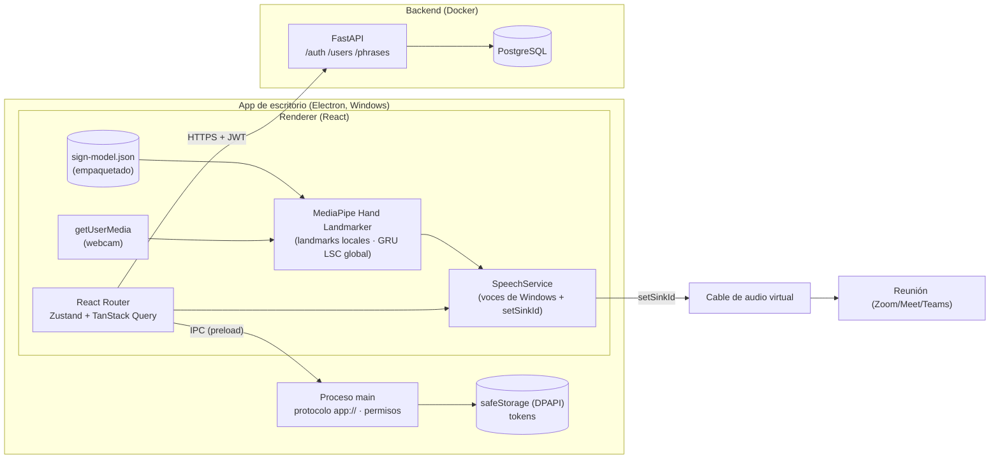

# Arquitectura de SeñaVoz

## Vista general

## Estructura

- `backend/app/api`: routers finos (auth, users, phrases, health) → `services/` (lógica) → `db/models.py`.
- `backend/app/core`: config (pydantic-settings), seguridad (Argon2, JWT, SHA-256), dependencias (usuario actual).
- `desktop/src/main`: arranque de Electron. Protocolo `app://senavoz` (`appProtocol.ts`, resolución segura de rutas), permisos y navegación (`security.ts`), almacén de tokens cifrado (`tokenStore.ts`) y User-Agent ASCII (`userAgent.ts`). La lógica va en funciones puras con dependencias inyectadas, testeadas sin Electron.
- `desktop/src/preload`: expone con `contextBridge` solo `window.senavoz.tokens.{get, save, clear}`.
- `desktop/src/shared/ipc.ts`: contrato IPC (tipos y nombres de canal) compartido por main, preload y renderer.
- `desktop/src/renderer/src`:
  - `routes/`: pantallas y guard (`RequireAuth` / `RequireGuest` según `useSession().status`).
  - `api/`: cliente axios + interceptor.
  - `store/`: Zustand (sesión, ajustes).
  - `services/`: voz, cámara y reconocimiento, detrás de interfaces.
  - `hooks/`: atajos de teclado.
  - `ui/`: componentes.
  - `i18n/`: textos.

## Autenticación

1. `login` devuelve access (JWT, 15 min) + refresh (aleatorio opaco, 7 días).
2. El servidor guarda **solo el SHA-256** del refresh en `refresh_tokens`.
3. `refresh` **rota**: marca el token usado como `revoked_at` y `replaced_by = nuevo`.
4. Reutilizar un refresh ya revocado se interpreta como posible robo: se revocan **todos** los refresh del usuario.
5. `logout` revoca el refresh recibido (idempotente).
6. En la app, ante un 401 el interceptor hace **un único** refresh, compartido por todas las peticiones concurrentes, y reintenta. Si falla, borra los tokens y cierra la sesión.
7. Los tokens viven cifrados en el proceso main (`safeStorage`). El renderer los pide por IPC y guarda una copia en memoria. Si el cifrado del sistema no está disponible, `save` falla y la sesión no se guarda.

Los errores de login son genéricos ("Correo o contraseña incorrectos"). Cuando el email no existe, Argon2 verifica contra un hash señuelo, para no filtrar si existe ni por mensaje ni por tiempo.

## Modelo de datos

Migración `0001`: `users`, `refresh_tokens`, `phrases`. Las migraciones `0002` y `0003` crearon `sign_samples` y `sign_models` (modelo por usuario); la migración `0004` las elimina: el modelo de señas es global y va dentro de la app.

## Decisiones

**App de escritorio (Electron).** La app corre en el mismo PC que la videollamada. Así la voz puede ir directamente a un cable de audio virtual que la reunión usa como micrófono, sin companion ni WebSocket. Electron permite reutilizar la lógica TS del MVP móvil y ejecutar `@mediapipe/tasks-vision` (WASM/GPU) en el renderer sin código nativo. Plataforma objetivo: Windows.

**Protocolo propio `app://senavoz`.** La UI no se carga desde `file://`, cuyo origen `null` complica CORS y la CSP. `app://senavoz` da un origen estable que el backend autoriza en `CORS_ORIGINS`, y el handler solo sirve archivos dentro de la carpeta de la UI. Electron incluye el nombre de la app en el User-Agent, así que se normaliza a ASCII: con la ñ, Chromium rechaza las subpeticiones de `app://`.

**Proceso main mínimo y aislado.** Main solo gestiona ventana, protocolo, permisos (solo cámara) y tokens. Toda la lógica de producto está en el renderer, con `contextIsolation` + `sandbox`. El preload expone una API de tres funciones.

**Visión local.** MediaPipe Hand Landmarker detecta hasta dos manos en el renderer y produce landmarks; nunca se envía vídeo. El archivo del detector y el WASM con SIMD se empaquetan localmente. La ventana son 30 frames tomados cada `FRAME_INTERVAL_MS`; sin manos en la ventana no se ejecuta el modelo.

El artefacto de detección de manos incluido es el modelo oficial [Hand Landmarker](https://storage.googleapis.com/mediapipe-models/hand_landmarker/hand_landmarker/float16/1/hand_landmarker.task); MediaPipe lo utiliza para extraer keypoints y no para clasificar señas del catálogo.

**Datos y modelo de señas.** Un único modelo de Lengua de Señas Colombiana, entrenado offline en `training/` con LSC-54 (Mora-Zarate, Garzón-Castro y Castellanos-Rivillas, 2025; CC BY-NC 4.0) y empaquetado en la app como `sign-model.json`. Los landmarks del dataset se extraen de sus vídeos con el mismo Hand Landmarker que la app, y la normalización de `training/` y la de la app se verifican con un fixture de paridad. La validación es por persona (personas no vistas en el entrenamiento) y solo se exportan las señas con ≥ 80 % de acierto. La clase `neutral` (manos bajadas o quietas, en parte sintética) nunca produce frase. El catálogo es mixto: las frases con seña se reconocen; el resto se dice con clic o atajo. La app ejecuta la GRU en TypeScript puro, verificada contra PyTorch con un fixture y sin runtimes de ML. Spec: `docs/superpowers/specs/2026-10-14-global-sign-model-design.md`.

**TTS pregenerado/cacheado.** Las frases son un conjunto cerrado y pequeño. Se pueden pregenerar con una voz de más calidad que la del sistema y reproducirlas localmente. `SpeechService` lo abstrae: `GeneratedSpeechService` reproduce el audio generado con las voces de Windows (precargado para todo el catálogo) y, solo fuera del Modo reunión, cae a `WebSpeechService` si la síntesis falla.

**Audio hacia la reunión (Modo reunión).** El main genera WAV con las voces OneCore de Windows (`resources/tts/synth.ps1`, WinRT vía PowerShell) y los guarda en `userData/tts-cache/` por voz + velocidad + texto. El renderer los reproduce con `HTMLAudioElement.setSinkId()` hacia VB-Cable ("CABLE Input"), que la reunión usa como micrófono ("CABLE Output"). En Modo reunión la voz nunca sale por los altavoces. La ventana se vuelve compacta y siempre visible, y Ctrl+Alt+1…9 funcionan con la reunión enfocada. Spec: `docs/superpowers/specs/2026-10-07-meeting-mode-design.md`.

**Interfaces desacopladas.** `SignRecognizer` y `SpeechService` son el contrato entre la UI y las capacidades cambiantes. `MediaPipeSignRecognizer` implementa la detección de manos, admite cambiar de clasificador sin reiniciar la cámara; la pantalla de cámara no depende directamente de MediaPipe.

## Roadmap

### Modelo de señas global — hecho

Ver la spec `docs/superpowers/specs/2026-10-14-global-sign-model-design.md` y el plan `docs/superpowers/plans/2026-10-14-global-sign-model.md`.

### Modelo de señas por usuario — sustituido por el modelo global

Ver la spec `docs/superpowers/specs/2026-10-07-trained-sign-model-design.md` y el plan `docs/superpowers/plans/2026-10-07-trained-sign-model.md`.

### Modo reunión — hecho

Ver la spec `docs/superpowers/specs/2026-10-07-meeting-mode-design.md` y el plan `docs/superpowers/plans/2026-10-07-meeting-mode.md`.
